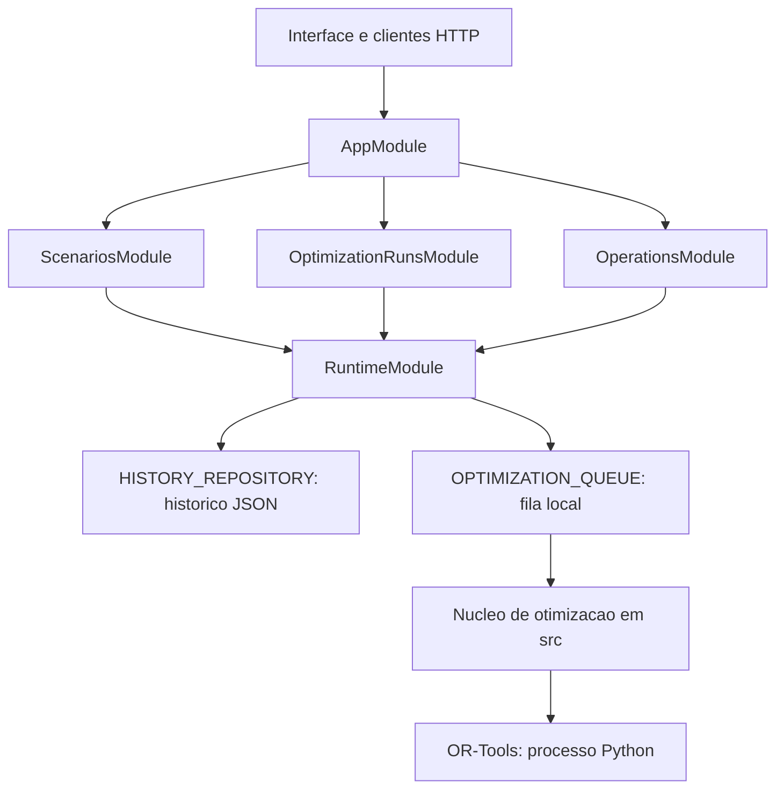

# Arquitetura do Backend NestJS

O backend e um monolito modular NestJS 12 com adaptador Express. Ele serve a
interface local, recebe cenarios e agenda execucoes usando o mesmo nucleo de
otimizacao dos comandos CLI. A migracao substitui o roteador manual HTTP por
controllers NestJS, preservando URLs, status, envelopes JSON, logs e metricas.

## Modulos e dependencias



| Modulo | Responsabilidade |
| --- | --- |
| `AppModule` | Compor os modulos e compartilhar uma unica configuracao de runtime por aplicacao. |
| `ScenariosModule` | Controllers de validacao, criacao e consulta de cenarios. |
| `OptimizationRunsModule` | Controllers de enfileiramento e consulta de execucoes. |
| `OperationsModule` | Healthcheck, metricas Prometheus e assets da interface. |
| `RuntimeModule` | Prover repositorio e fila por injecao de dependencias e aguardar a fila ao encerrar a aplicacao. |

Os controllers em `backend/` delegam aos handlers existentes em `src/api/`.
Esses handlers continuam usando a validacao do dominio, o repositorio e a fila
recebidos pelo `ApiContext`. As regras dos solvers, simulacoes e previsoes
permanecem em `src/`, sem importar NestJS. O roteador `src/api/router.js` foi
removido; a tabela de rotas pertence aos controllers.

Os tokens `HISTORY_REPOSITORY` e `OPTIMIZATION_QUEUE` sao exportados pelo modulo
de runtime. Todos os modulos de funcionalidade importam a mesma instancia do
modulo dinamico, compartilhando um repositorio e uma fila por aplicacao. Nao
existem providers globais nem estado de configuracao compartilhado entre apps.

## Persistencia e processamento

O MVP conserva o repositorio JSON local e a fila em memoria. A fila registra
`QUEUED`, `RUNNING`, `SUCCEEDED` e `FAILED`, aplica tentativas e registra limites
de duracao, como antes. Os eventos mantem os identificadores de correlacao.
Os contratos estao em [optimization-history.md](optimization-history.md) e
[scenario-run-api.md](scenario-run-api.md).

O job e agendado depois da requisicao inicial, mas o solver continua sincrono
no processo Node.js da API. Ele pode bloquear outras requisicoes enquanto
executa. `OPTIFLOW_RUN_CONCURRENCY` limita jobs em andamento; nao cria threads
ou processos de worker. O timeout da fila e verificado ao terminar o solver;
o adaptador OR-Tools tambem limita o processo Python. A arquitetura atual nao
oferece isolamento de CPU nem interrupcao preventiva de todos os solvers.

O arquivo JSON pressupoe um unico processo escritor e o volume Docker conserva
resultados entre reinicios. Jobs em memoria nao sao recuperados depois de uma
queda. Nao execute replicas da API compartilhando esse arquivo.

Uma futura troca por banco transacional e fila duravel deve implementar os
mesmos contratos de repositorio e fila, com worker separado e recuperacao de
jobs. Essas tecnologias nao sao dependencias desta entrega.

## HTTP e encerramento

- `bodyParser: false` desativa o parser automatico do Express. O leitor JSON
  existente limita o corpo a 1 MiB e mantem `invalid_json` e `body_too_large`.
- `ApiErrorFilter` conserva `{ error: { code, message, details } }` para erros
  dos handlers e rotas inexistentes.
- `SIGINT` e `SIGTERM` acionam os hooks do NestJS. O fechamento da aplicacao
  encerra o servidor HTTP e aguarda `runQueue.onIdle()` para terminar os jobs
  locais aceitos. Uma interrupcao forcada ainda pode perder jobs.

As rotas e variaveis de ambiente continuam em
[scenario-run-api.md](scenario-run-api.md). A interface usa os mesmos caminhos
relativos e e servida pela API.

## Build e uso local

```bash
npm ci
npm run build
npm test
npm run api
```

`npm run build` compila somente `backend/**/*.ts` para `dist/`, como ES modules.
`pretest` e `preapi` executam esse build automaticamente. O nucleo JavaScript
permanece no local original, incluindo os caminhos da ponte Python. O
compilador usa verificacao estrita, com `noImplicitAny: false` para importar os
modulos JavaScript que ainda nao possuem declaracoes TypeScript.

A factory interna mudou de `createOptiFlowApiServer()` sincrona para
`await createOptiFlowApplication()`, exportada em `src/api-server.js`. Ela
retorna uma aplicacao NestJS inicializada; use `await app.listen(port, host)`
e `await app.close()`. Scripts que importam a factory diretamente precisam de
`npm run build` antes da execucao. Os comandos publicos `npm run api` e
`npm test` fazem isso automaticamente.

A factory aceita `repository`, `runQueue`, `solve`, `logger` e as opcoes de
limites e ambiente para compor adaptadores ou testes sem alterar o dominio.
Uma fila injetada deve oferecer `enqueue()`, `getStats()` e `onIdle()`.

A imagem Docker usa um estagio de build com TypeScript e instala somente as
dependencias de producao no runtime. Ela inicia `node scripts/start-api.js`
com o backend ja compilado, sem precisar do compilador em producao.

## Evidencias

`test/api-server.test.js` executa o servidor NestJS real em porta efemera e
verifica validacao, persistencia, heuristica, enumeracao, OR-Tools, erros,
assets, metricas e correlacao. Os testes da migracao cobrem tambem limite do
corpo, rotas inexistentes, repositorio compartilhado entre modulos, retry do
solver injetado e espera da fila no encerramento.

Referencias do framework: [modulos](https://docs.nestjs.com/modules),
[providers customizados](https://docs.nestjs.com/fundamentals/custom-providers),
[filtros de excecao](https://docs.nestjs.com/exception-filters) e
[ciclo de vida](https://docs.nestjs.com/fundamentals/lifecycle-events).
